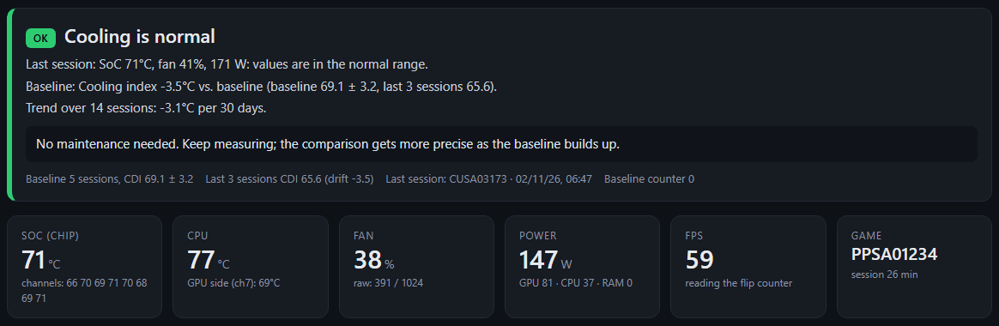
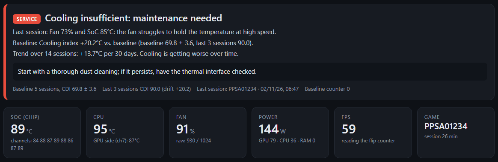
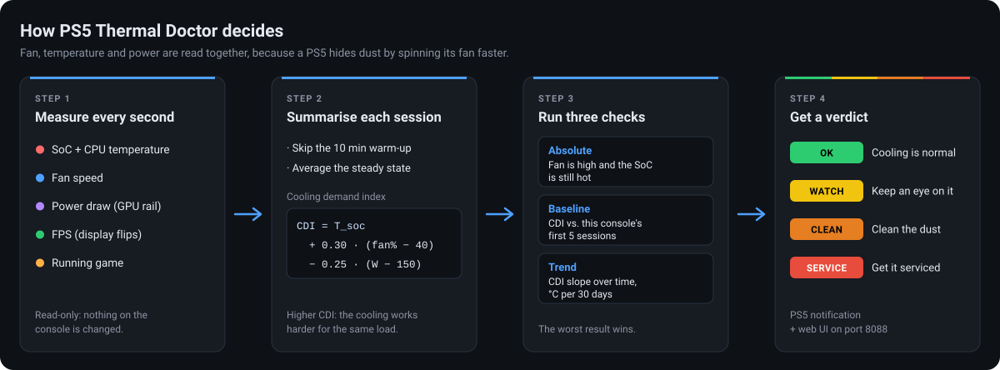
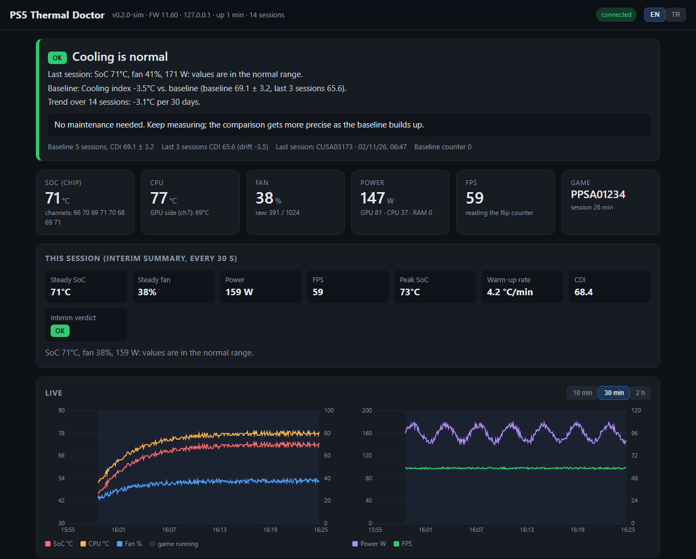
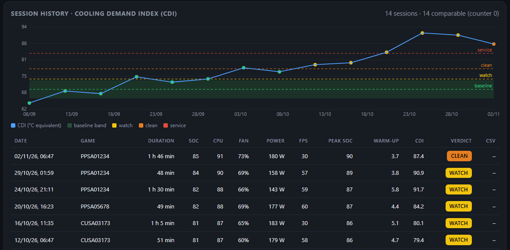

# PS5 Thermal Doctor

**English** · [Türkçe](README.tr.md)

### Know when your PS5 needs cleaning, before it overheats.

PS5 Thermal Doctor is a background payload for jailbroken PS5 consoles. While you play, it watches how hard the cooling system has to work. It compares every session with your console's own history, and when the game closes it tells you plainly: **cooling is fine**, **keep an eye on it**, **clean the dust** or **get it serviced**.





<sub>Top: a healthy console. Bottom: a console whose heatsink is clogged with dust. Screenshots from the built-in simulator.</sub>

**[Download the latest release](https://github.com/Jlozde/PS5-Thermal-Doctor/releases/latest)** · [Install guide](docs/INSTALL.md) · [How the verdict works](docs/ANALYSIS.md) · [Changelog](CHANGELOG.md)

> **Note:** It does not run on a normal (non-jailbroken) PS5. It needs firmware 4.03–14.10 and the etaHEN / elfldr loader.

## Why

Dust builds up slowly, over months. A PS5 does not warn you about it: its fan controller simply spins the fan faster to keep the chip at the same temperature. The temperature therefore looks fine for a long time, until the console gets loud, the fan runs flat out and the console finally shuts down to protect itself.

Looking at the temperature alone cannot catch this. PS5 Thermal Doctor reads **fan speed, temperature and power together** and works out how much cooling effort the console needs for the same load. When that effort creeps up compared with the console's own baseline, it tells you to clean it, long before it overheats.

- **Read-only.** No overlay, no fan control, no tuning. It reads sensors and never changes anything on the console.
- **Results where you look.** A PS5 notification when the game closes, and a web UI on your phone or PC.
- **English and Turkish.** Every text a user sees is available in both languages.

## How it works



1. **Absolute rules**, from the first session: if the fan is high **and** the temperature is still high, cooling is insufficient.
   Default thresholds: WATCH 60% / 76 °C · CLEAN 70% / 80 °C · SERVICE 85% / 86 °C.
2. **Comparison with a baseline**: the first 5 sessions form the baseline. Each session gets a *cooling demand index*:
   `CDI = T_soc + 0.30·(fan% − 40) − 0.25·(W − 150)`. A console that does the same work hotter and with a faster fan gets a higher CDI. Against the baseline, +4 °C is WATCH, +8 °C is CLEAN and +14 °C is SERVICE.
3. **Trend**: with 6+ sessions over 14+ days, the monthly slope of the CDI is computed. +2 °C per month or more raises a warning.

After cleaning, the **"New baseline"** button in the web UI resets the comparison. Details: [docs/ANALYSIS.md](docs/ANALYSIS.md).

## What you see



<sub>The web UI during a game: overall verdict, live sensor values, an interim summary every 30 s, and live temperature, fan, power and FPS charts.</sub>



<sub>Session history of a console getting dustier over two months. The cooling demand index climbs through the watch, clean and service lines.</sub>

## What it reads

| Data | Source |
|---|---|
| CPU and SoC temperature (8 channels) | `sceKernelGetCpuTemperature`, `sceKernelGetSocSensorTemperature` |
| Fan speed (%) | `sceKernelGetCurrentFanDuty` (raw value 0–1024) |
| Power (W): GPU, CPU and memory rails | `sceKernelGetSocPowerConsumption` |
| FPS | `/dev/dce` display flip counter (does not touch the game) |
| Running game | `sceSystemServiceGetAppIdOfRunningBigApp` + `/mnt/sandbox/pfsmnt` |
| System language | `sceSystemServiceParamGetInt` (for `lang = auto`) |

## Setup

1. Download `ps5-thermal-doctor.elf` from the [latest release](https://github.com/Jlozde/PS5-Thermal-Doctor/releases/latest). To build it yourself, see [docs/INSTALL.md](docs/INSTALL.md).
2. Make sure the PS5 is jailbroken and etaHEN (or elfldr) is running.
3. Send the payload:
   ```powershell
   powershell -ExecutionPolicy Bypass -File .\tools\send_payload.ps1 -Ip 192.168.1.50 -Elf .\ps5-thermal-doctor.elf -Watch
   ```
   On Linux: `nc -q0 192.168.1.50 9021 < ps5-thermal-doctor.elf`
4. The PS5 shows a "PS5 Thermal Doctor started · http://IP:8088" notification. Open that address in a phone or PC browser.
5. Start a game and play for at least **15 minutes**. A summary notification arrives when the game closes.

The payload has to be sent again after every console restart. etaHEN can start it automatically: copy the ELF to `/data/etaHEN/payloads/` and enable auto-start in the Toolbox.

## Language

| Where | How the language is chosen |
|---|---|
| Web UI | The **EN / TR** buttons in the header, or `?lang=en` / `?lang=tr` in the address. The first visit follows the browser language; the choice is remembered in the browser. |
| PS5 notifications, log file, payload output | The `lang` key in `config.ini`: `auto` (PS5 system language, Turkish → Turkish, anything else → English), `en` or `tr`. |
| JSON API | `?lang=en` or `?lang=tr` on `/api/status` and `/api/log`. Without it, the console language is used. |
| `config.ini` | Every key has a comment line in both languages. |

The in-memory log keeps every line in both languages, so switching the web UI language also switches the log view.

## Files on the console

```
/data/ps5td/config.ini      settings (editable from the web UI)
/data/ps5td/history.csv     session summaries
/data/ps5td/sessions/*.csv  raw data per session, every 5 s
/data/ps5td/state.ini       baseline counter
/data/ps5td/ps5td.log       log
```

## Project layout

```
src/analysis.c       diagnosis logic (portable, tested on a PC)
src/i18n.c           language selection (en / tr)
src/log.c            bilingual log (ring buffer + file)
src/platform.c       PS5 hardware access (sensors, dce, notifications, system language)
src/sampler.c        1 Hz sampling, session handling, CSV
src/http.c           web server + JSON API
web/index.html       web UI (embedded into the ELF)
tools/build.ps1      Windows build without WSL
tools/send_payload.ps1   sends the ELF to elfldr
tools/devserver.py   fake server for trying the UI on a PC
test/                PC tests and syntax check (test\host-check.ps1)
docs/                install guide, diagnosis logic, README images
```

## Development

```powershell
powershell -ExecutionPolicy Bypass -File .\test\host-check.ps1   # diagnosis tests + syntax check (MinGW gcc)
python tools\devserver.py                                        # http://localhost:8088, healthy console
$env:PS5TD_SIM="dusty"; python tools\devserver.py                 # dusty console scenario
$env:PS5TD_LANG="tr"; python tools\devserver.py                   # simulate a Turkish console
```

On Linux: `make test`. Pushing a `v*` tag publishes a release through GitHub Actions; see [docs/INSTALL.md](docs/INSTALL.md#b-github-actions).

## Credits / sources

The API details were learned from these open source projects: [etaHEN](https://github.com/etaHEN/etaHEN), [OnionHEN](https://github.com/aydencharles/onionHEN), [PS5 Cooling & System Center](https://github.com/strongt1me/ps5-cooling-system-center-pro), [ps5-fan-control](https://github.com/owendswang/ps5-fan-control), [PS5 Overlay KUS](https://github.com/smoxa/ps5-new-overlay), PHU Games Tools (ArkSama) and [ps5-payload-sdk](https://github.com/ps5-payload-dev/sdk). License: GPL-3.0-or-later ([LICENSE](LICENSE)).
