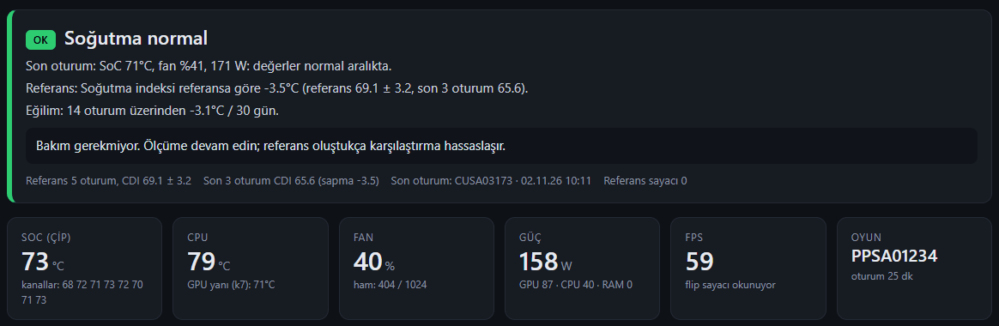
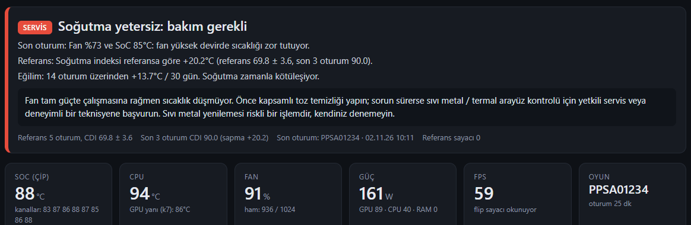
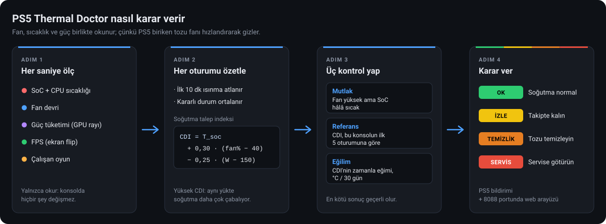
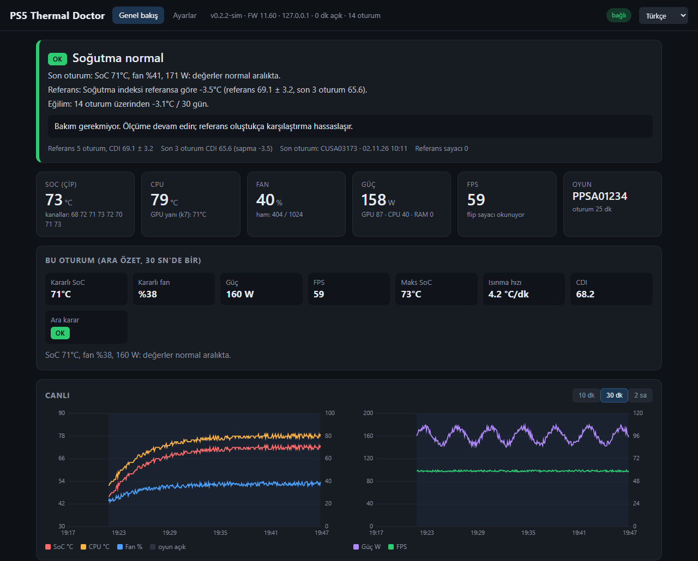
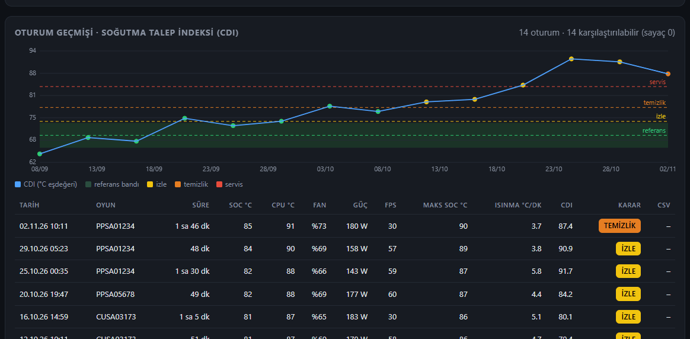
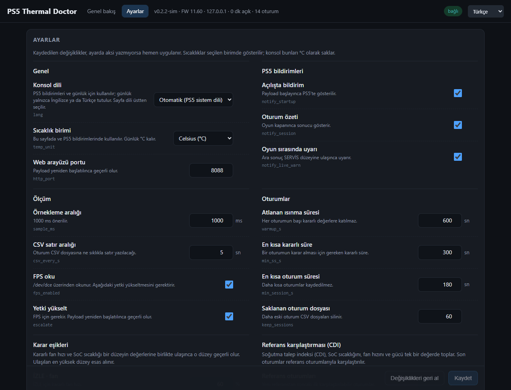

# PS5 Thermal Doctor

[English](README.md) · **Türkçe**

### PS5'inizin temizliğe ne zaman ihtiyaç duyduğunu, ısınıp kapanmadan önce öğrenin.

PS5 Thermal Doctor, jailbreak'li PS5 için bir arka plan payload'ıdır. Siz oynarken soğutma sisteminin ne kadar zorlandığını izler. Her oturumu konsolun kendi geçmişiyle karşılaştırır ve oyun kapanınca sonucu açıkça söyler: **soğutma normal**, **takipte kalın**, **tozu temizleyin** ya da **servise götürün**.





<sub>Üstte sağlıklı bir konsol, altta soğutucusu tozla tıkanmış bir konsol. Görüntüler yerleşik simülatörden alınmıştır.</sub>

**[Son sürümü indirin](https://github.com/Jlozde/PS5-Thermal-Doctor/releases/latest)** · [Kurulum rehberi](docs/INSTALL.tr.md) · [Karar nasıl verilir](docs/ANALYSIS.tr.md) · [Değişiklik günlüğü](CHANGELOG.tr.md)

> **Not:** Normal (jailbreak'siz) PS5'te çalışmaz. Firmware 4.03–14.10 arası ve etaHEN / elfldr yükleyicisi gerekir.

> [!IMPORTANT]
> **Sorumluluk reddi.** PS5 Thermal Doctor bir teşhis değil, tahmin sunar ve %100 doğru olduğunu iddia etmez. Konsolun içini göremez; soğutmanın durumunu sensör okumalarından ve hâlâ ayarlanmakta olan eşiklerden çıkarır.
>
> - **Sağlıklı sonuç bir garanti değildir.** OK görünen bir konsolda da biriken toz, yıpranmış fan ya da bozulmuş termal arayüz gibi bir sorun olabilir. Önce kendi incelemeniz gelir: alışılmadık fan sesi, çok sıcak çıkan hava, havalandırmada görünen toz ya da beklenmedik kapanmalar.
> - **Sağlıksız görünen sonuç hızlı müdahale ister.** TEMİZLİK veya SERVİS görünüyorsa ya da konsol çok ısınıyorsa, oyuna ara verip konsolu kısa sürede kontrol edin. Soğutma sorunları genellikle kötüleşir; aşırı ısınan konsol kapanabilir ya da zarar görebilir.
> - **Kullanım sorumluluğu size aittir.** Payload çalıştırmak jailbreak'li konsol gerektirir. Yazarlar hasar, veri kaybı veya garanti kaybından sorumlu tutulamaz.

## Neden

Toz aylar içinde yavaş yavaş birikir. PS5 bu konuda sizi uyarmaz: fan kontrolcüsü çipi aynı sıcaklıkta tutmak için fanı biraz daha hızlandırır. Bu yüzden sıcaklık uzun süre normal görünür; ta ki konsol gürültülü çalışmaya başlayana, fan son hıza çıkana ve sonunda konsol kendini korumak için kapanana kadar.

Yalnızca sıcaklığa bakarak bu yakalanamaz. PS5 Thermal Doctor **fan devrini, sıcaklığı ve gücü birlikte** okur ve konsolun aynı yük için ne kadar soğutma çabası harcadığını hesaplar. Bu çaba konsolun kendi referansına göre artmaya başladığında, ısınma sorunu çıkmadan çok önce temizlik zamanının geldiğini söyler.

- **Yalnızca okur.** Overlay yok, fan kontrolü yok, ayar değiştirme yok. Sensörleri okur ve konsolda hiçbir şeyi değiştirmez.
- **Sonuç baktığınız yerde.** Oyun kapanınca PS5 bildirimi, telefonda veya PC'de web arayüzü.
- **Uygulamada sekiz dil.** Web arayüzü, kararlar ve PS5 bildirimleri İngilizce, Türkçe, Almanca, Fransızca, İspanyolca, Rusça, Korece ve Basitleştirilmiş Çince olarak kullanılabilir. Günlük ve `config.ini` açıklamaları İngilizce ve Türkçe kalır.
- **°C veya °F.** Varsayılan Celsius; Ayarlar sekmesinden Fahrenheit seçilebilir.

## Nasıl çalışır



1. **Mutlak kurallar**, ilk oturumdan itibaren: fan yüksek **ve** sıcaklık hâlâ yüksekse soğutma yetersizdir.
   Varsayılan eşikler: İZLE %60 / 76 °C · TEMİZLİK %70 / 80 °C · SERVİS %85 / 86 °C.
2. **Referansla karşılaştırma**: ilk 5 oturum referanstır. Her oturum için *soğutma talep indeksi* hesaplanır:
   `CDI = T_soc + 0,30·(fan% − 40) − 0,25·(W − 150)`. Aynı işi daha sıcak ve daha hızlı fanla yapan cihazın CDI'sı yükselir. Referansa göre +4 °C İZLE, +8 °C TEMİZLİK, +14 °C SERVİS'tir.
3. **Eğilim**: 14 günden uzun sürede 6+ oturum varsa CDI'nin aylık eğimi hesaplanır. Ayda +2 °C ve üzeri uyarı verir.

Temizlik yaptıktan sonra web arayüzünün Ayarlar sekmesindeki **"Yeni referans"** düğmesi karşılaştırmayı sıfırlar. Ayrıntı: [docs/ANALYSIS.tr.md](docs/ANALYSIS.tr.md).

## Ne görürsünüz



<sub>Oyun sırasında web arayüzü: genel karar, canlı sensör değerleri, 30 sn'de bir ara özet ve canlı sıcaklık, fan, güç ve FPS grafikleri.</sub>



<sub>İki ay içinde giderek tozlanan bir konsolun oturum geçmişi. Soğutma talep indeksi izle, temizlik ve servis çizgilerini sırayla geçiyor.</sub>



<sub>Ayarlar sekmesi: konsol dili, sıcaklık birimi, bildirimler, ölçüm ve tüm karar eşikleri, her biri kısa bir açıklamayla. Sıcaklıklar varsayılan olarak °C gösterilir, °F'ye geçilebilir.</sub>

## Ne okur

| Veri | Kaynak |
|---|---|
| CPU ve SoC sıcaklığı (8 kanal) | `sceKernelGetCpuTemperature`, `sceKernelGetSocSensorTemperature` |
| Fan devri (%) | `sceKernelGetCurrentFanDuty` (0–1024 ham değer) |
| Güç (W): GPU, CPU ve bellek rayları | `sceKernelGetSocPowerConsumption` |
| FPS | `/dev/dce` ekran flip sayacı (oyuna dokunmadan) |
| Çalışan oyun | `sceSystemServiceGetAppIdOfRunningBigApp` + `/mnt/sandbox/pfsmnt` |
| Sistem dili | `sceSystemServiceParamGetInt` (`lang = auto` için) |

## Kurulum

1. `ps5-thermal-doctor.elf` dosyasını [son sürümden](https://github.com/Jlozde/PS5-Thermal-Doctor/releases/latest) indirin. Kendiniz derlemek için [docs/INSTALL.tr.md](docs/INSTALL.tr.md).
2. PS5'te jailbreak ve etaHEN (veya elfldr) çalışır durumda olsun.
3. Payload'ı gönderin:
   ```powershell
   powershell -ExecutionPolicy Bypass -File .\tools\send_payload.ps1 -Ip 192.168.1.50 -Elf .\ps5-thermal-doctor.elf -Watch
   ```
   Linux'ta: `nc -q0 192.168.1.50 9021 < ps5-thermal-doctor.elf`
4. PS5 ekranında "PS5 Thermal Doctor başladı · http://IP:8088" bildirimi görünür. O adresi telefon veya PC tarayıcısında açın.
5. Bir oyun açıp en az **15 dakika** oynayın. Oyun kapanınca özet bildirimi gelir.

Payload her konsol yeniden başlatmasında tekrar gönderilmelidir. etaHEN bunu otomatik yapabilir: ELF'i `/data/etaHEN/payloads/` altına kopyalayıp Toolbox'ta auto-start'ı açın.

## Dil

| Nerede | Dil nasıl seçilir |
|---|---|
| Web arayüzü | Başlıktaki dil menüsü ya da adreste `?lang=` (`en`, `tr`, `de`, `fr`, `es`, `ru`, `ko`, `zh`). İlk ziyarette tarayıcı dili kullanılır; seçim tarayıcıda hatırlanır. |
| PS5 bildirimleri | Ayarlar sekmesindeki **Konsol dili** (`config.ini` içindeki `lang` anahtarı): `auto` PS5 sistem dilini izler (uygulamada olmayan bir dil → İngilizce) ya da yukarıdaki kodlardan biri. |
| Günlük dosyası, payload çıktısı | İngilizce veya Türkçe: konsol dili Türkçe ise Türkçe, değilse İngilizce. |
| JSON API | `/api/status` ve `/api/log` için yukarıdaki kodlardan biriyle `?lang=`. Verilmezse konsol dili kullanılır. |
| `config.ini` | Her anahtarın İngilizce ve Türkçe açıklama satırı vardır. Ayarlar sekmesi aynı anahtarları düzenler. |

Bellekteki günlük her satırı İngilizce ve Türkçe tutar. Bu yüzden web arayüzünü bu iki dil arasında değiştirmek günlük görünümünü de değiştirir. Diğer dillerde günlük İngilizce gösterilir.

## Konsoldaki dosyalar

```
/data/ps5td/config.ini      ayarlar (web arayüzünün Ayarlar sekmesinden düzenlenir)
/data/ps5td/history.csv     oturum özetleri
/data/ps5td/sessions/*.csv  oturum başına 5 sn'lik ham veri
/data/ps5td/state.ini       referans sayacı
/data/ps5td/ps5td.log       günlük
```

## Proje yapısı

```
src/analysis.c       teşhis mantığı (taşınabilir, PC'de test edilir)
src/i18n.c           dil seçimi (8 dil)
src/texts.h          oyuncuya görünen metinler, tools/gen_i18n.py üretir
src/log.c            İngilizce / Türkçe günlük (halka tampon + dosya)
src/platform.c       PS5 donanım erişimi (sensörler, dce, bildirim, sistem dili)
src/sampler.c        1 Hz örnekleme, oturum yönetimi, CSV
src/http.c           web sunucusu + JSON API
web/index.html       web arayüzü (ELF'e gömülür)
tools/build.ps1      WSL'siz Windows derlemesi
tools/send_payload.ps1   ELF'i elfldr'a gönderir
tools/devserver.py   arayüzü PC'de denemek için sahte sunucu
tools/i18n_texts.py  uygulama metinlerinin çevirileri (tek kaynak)
tools/gen_i18n.py    src/texts.h dosyasını ve web/index.html içindeki metin tablosunu yazar
test/                PC testleri ve sözdizimi denetimi (test\host-check.ps1)
docs/                kurulum rehberi, teşhis mantığı, README görselleri
```

## Geliştirme

```powershell
powershell -ExecutionPolicy Bypass -File .\test\host-check.ps1   # teşhis testleri + sözdizimi denetimi (MinGW gcc)
python tools\devserver.py                                        # http://localhost:8088, sağlıklı konsol
$env:PS5TD_SIM="dusty"; python tools\devserver.py                 # tozlu konsol senaryosu
$env:PS5TD_LANG="tr"; python tools\devserver.py                   # Türkçe konsol simülasyonu
python tools\gen_i18n.py                                         # tools\i18n_texts.py düzenlendikten sonra
```

Linux'ta: `make test`. `v*` etiketi gönderildiğinde GitHub Actions bir release yayınlar; bkz. [docs/INSTALL.tr.md](docs/INSTALL.tr.md#b-github-actions).

## Teşekkür / kaynaklar

API bilgileri şu açık kaynak projelerden öğrenildi: [etaHEN](https://github.com/etaHEN/etaHEN), [OnionHEN](https://github.com/aydencharles/onionHEN), [PS5 Cooling & System Center](https://github.com/strongt1me/ps5-cooling-system-center-pro), [ps5-fan-control](https://github.com/owendswang/ps5-fan-control), [PS5 Overlay KUS](https://github.com/smoxa/ps5-new-overlay), PHU Games Tools (ArkSama) ve [ps5-payload-sdk](https://github.com/ps5-payload-dev/sdk). Lisans: GPL-3.0-or-later ([LICENSE](LICENSE)).
